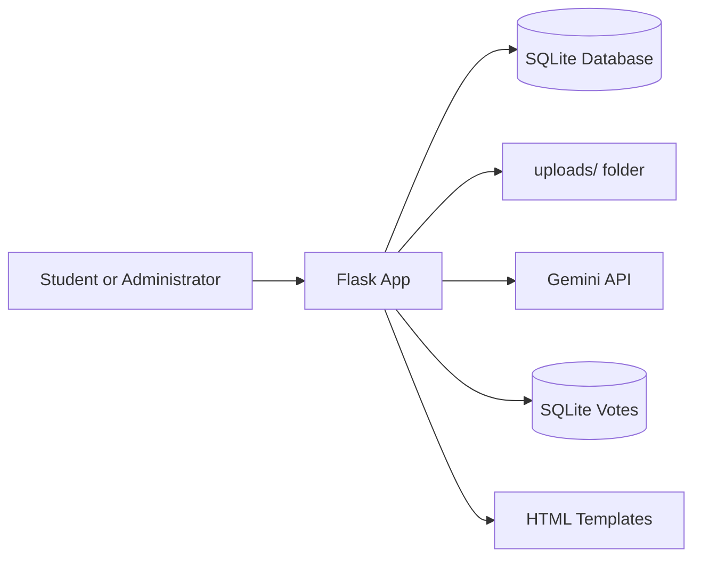
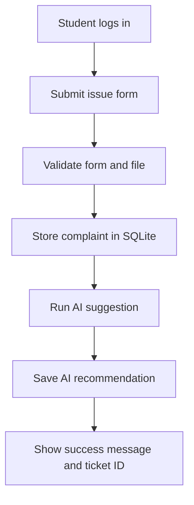

# High-Level Design (HLD)

## Overview

CampusFix is a single-application Flask service that allows students to submit and track campus infrastructure complaints. Administrators can review all tickets, update status, and use AI suggestions as decision support.

## Users

- Student users: register, log in, submit tickets, view their own complaints
- Administration users: review all tickets, filter data, change status, inspect history

## Main components

1. Flask web app
   - Handles pages and business logic
2. SQLite database
   - Stores users, complaints, and status actions
3. Uploaded file storage
   - Stores complaint images locally in `uploads/` (served only to the reporting student and admins)
4. Gemini service
   - Provides category and priority suggestions when configured
5. SQLite vote records
   - Stores one changeable upvote or downvote per student and issue
6. Templates and static assets
   - Deliver the UI using HTML, CSS, and Bootstrap

## Architecture diagram

## Complaint flow

## Design notes

A simple layered design keeps the project beginner-friendly. The UI is served by Flask templates. The database layer manages persistent data. The Gemini service is isolated so that missing API keys or failures do not break the complaint flow.

Resolved complaints are shown in regular lists for one day, then appear in the archive. They remain in SQLite; no scheduled job or extra service is needed. Students can vote on unresolved issues, and each student can change or remove their vote.
