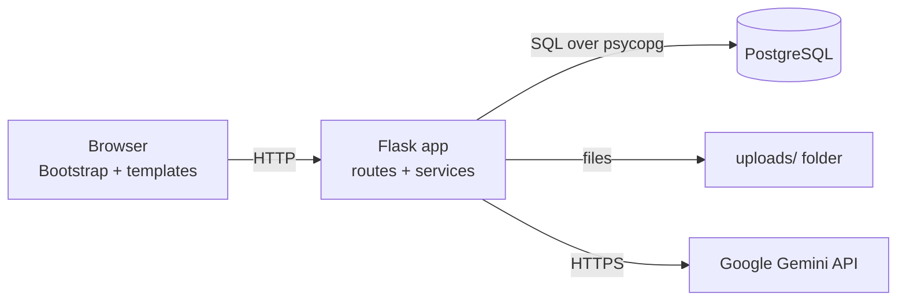

# CampusFix: High-Level Design

## 1. Purpose

CampusFix lets students report campus maintenance problems, lets the community vote on what is most urgent, and lets administrators triage and resolve tickets. An AI model suggests a category and priority to speed up triage, but it never decides anything by itself.

## 2. Users and roles

| Role | Can do |
|---|---|
| **Student** | Register, log in, report issues with a photo, vote, follow their own tickets, view the archive |
| **Administrator** | See all tickets, search and filter, update status, see AI suggestions, view all photos |
| **Visitor** | See the home page, register, log in |

Roles are enforced on the server for every protected route. New registrations are always students. Administrators are created from the command line or from environment variables.

## 3. Architecture

CampusFix is a server-rendered web application in three layers.

| Layer | Responsibility | Where |
|---|---|---|
| Presentation | HTML pages, forms, styling | `templates/`, `static/` |
| Application | Routing, validation, access control, business rules | `app.py`, `routes/`, `services/` |
| Data | Storage and queries | `database.py`, PostgreSQL |

### Components

| Component | Description |
|---|---|
| App factory (`app.py`) | Creates the Flask app, configures CSRF and error handlers, registers blueprints, provides the command-line entry point |
| Configuration (`config.py`) | Reads `.env`; holds limits and the shared lists of statuses, categories and priorities |
| Database module (`database.py`) | Connection handling, schema creation, admin bootstrap, shared SQL rules |
| Auth routes | Register, login, logout, and the `login_required` and `role_required` decorators |
| Student routes | Dashboard and "my tickets" |
| Issue routes | Report an issue, issue board and voting, archive, ticket details |
| Admin routes | Dashboard with search and filters, status updates |
| Main routes | Home page, protected photo download, health check |
| Gemini service | Asks the AI for a category and priority, and validates the answer |

## 4. Main flows

### 4.1 Reporting an issue

1. A logged-in student submits the form with a photo.
2. The server checks the fields, the category, and the photo (extension, size, pixel count, real content).
3. The photo is saved under a random name in `uploads/`.
4. The Gemini service suggests a category and priority. If the AI is unavailable, the ticket is still created.
5. The ticket and its first history entry (`New` to `Pending`) are saved in one transaction.
6. The student is shown the ticket ID, for example `CF-00042`.

### 4.2 Voting

A student votes up or down on an open issue. Voting again with the same value removes the vote, and the other value changes it. The database allows only one vote per student per issue. Resolved issues cannot be voted on.

### 4.3 Updating a ticket

An administrator picks a new status. The ticket and its `updated_at` are updated and a history row is added with the administrator's id, in one transaction.

### 4.4 Archive

Resolved tickets remain in normal lists for 24 hours after their last update, then appear only in the archive.

## 5. Data

Four tables: `users`, `complaints`, `status_history` and `complaint_votes`. Details are in `docs/DATABASE.md`.

## 6. Security design

| Concern | Measure |
|---|---|
| Authentication | Session-based login using a signed Flask cookie that stores the user id and role |
| Authorisation | Role-based access control. The user is reloaded from the database on every request, and the role is checked in the database, so a deleted user loses access immediately. |
| Passwords | Hashed with Werkzeug, never stored or logged in plain text |
| CSRF | Tokens on every form, checked on every POST |
| SQL injection | Parameterised queries only |
| Uploads | Extension, size, pixel count and content verified; random file names; served only to the owner and admins, with `nosniff` and 404 for everything else |
| Secrets | In `.env`, never committed; a random key is used if `SECRET_KEY` is missing |
| AI input | Complaint text is treated as untrusted; the AI answer is validated against fixed lists |

## 7. External dependencies

| Service | Used for | If unavailable |
|---|---|---|
| PostgreSQL | All data | The app cannot run |
| Google Gemini | Category and priority suggestions | Tickets are created without suggestions |
| Bootstrap CDN | Page styling | Pages lose styling |

